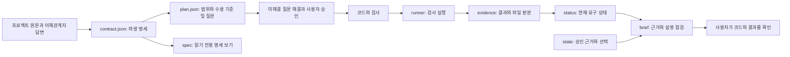

# 구현을 따라가며 보는 기능과 한계

이 문서는 사용자가 HX Spec Harness의 동작을 이해하고 다른 개발자에게 인계할 수 있도록 작성했습니다. 실제 기능의 올바름은 프로젝트의 원문, 검사 내용과 사용자가 관찰한 결과를 함께 봐야 판단할 수 있습니다.

## 실행 흐름

`hx.py`가 `hxkit/cli.py`의 명령을 시작합니다. `core.py`는 계약의 원문 인용과 경로, 검사 연결을 확인합니다. 또한 계획 구조와 질문 상태, 승인 당시 파일 판본을 확인합니다. `runner.py`는 명령을 실행하고 `unittest_adapter.py`는 개별 테스트 결과를 수집합니다. `data.py`는 CSV/TSV를 읽기 전용으로 점검합니다. `views.py`는 `spec`, `brief`와 로컬 `git-check` 출력을 만듭니다.

`init`은 빈 계획을 생성합니다. 계획에는 목표, 범위, 수용 기준, 모든 요구·검사를 포함하는 작업과 미해결 질문을 기록합니다. 계약과 계획을 작성할 때는 미래 구현 파일이 아직 없어도 됩니다. 실제 `check`는 필요한 추적 파일이 있는지 확인합니다. 질문을 해결하고 사용자에게 계획을 제시한 뒤 실제 승인 원문과 근거 위치를 `plan-approve`에 기록합니다. 로컬 승인 기록은 사용자 신원 인증이 아닙니다. 기존 상태에 계획이 없으면 자동 승인하지 않습니다.

승인 전에는 `plan`, `spec`, `status`, `doctor`, `inspect`, `join`, `git-check`로 조사할 수 있습니다. 계약과 계획을 수정하고 `decision --actor ai`로 제안을 남길 수도 있습니다. `check`와 `observe`는 유효한 승인 기록이 있어야 실행됩니다. `freeze`는 승인 전 완료 상태를 반환하지 않습니다. 조사와 AI 제안만으로 검사 완료나 사용자 관찰을 표시하지 않습니다.

계획, 계약 또는 원문이 승인 뒤 바뀌면 `plan_gate`는 `stale`이 됩니다. 그때 과거 검사와 수동 관찰을 현재 통과로 표시하지 않습니다. 변경한 계획을 다시 제시하고 실제 사용자 승인 근거를 새 판본으로 기록해야 합니다. 이후 필요한 검사를 다시 실행합니다. `check`는 각 검사 전에 승인 판본을 확인하고, 검사 후에 계획·계약·원문과 추적 파일 판본을 다시 확인합니다. 실행 중 판본이 바뀌면 통과로 쓰지 않고 뒤따르는 검사를 중단합니다. 원문 파일과 연결된 구현 경로, unittest의 `test_dir`는 함께 추적하지만, 선언하지 않은 모든 의존 파일을 자동으로 찾지는 못합니다. `spec`과 `brief`는 현재 상태를 읽고 출력하며 파일을 생성하거나 검사를 실행하지 않습니다.

| 선택 | 얻는 이점 | 감수한 한계 |
|---|---|---|
| 계약과 계획을 별도 로컬 파일로 사용합니다. | 요구·검사 연결과 승인받을 작업 범위를 각각 확인합니다. | 원문 해석과 실제 사용자 승인 여부는 사람이 확인해야 합니다. |
| Python 표준 라이브러리를 사용합니다. | 추가 설치 없이 로컬에서 시작할 수 있습니다. | 전용 개별 테스트 어댑터는 unittest입니다. 다른 언어는 명령 또는 JSON 비교로 연결합니다. |
| 파일 해시로 승인과 증거의 최신 여부를 확인합니다. | 승인 뒤 명세 변경과 검사 뒤 추적 파일 변경을 찾습니다. | 선언하지 않은 의존 파일과 의도적인 기록 위조를 막지 못합니다. |
| 명령 성공과 동작 검사를 구분합니다. | 빌드 성공을 곧바로 기능 완료로 보지 않습니다. | 기대값과 테스트가 원문을 잘 반영하는지 사람이 판단해야 합니다. |
| 수동 관찰을 자기보고로 둡니다. | 자동 검사와 사람의 확인을 분리합니다. | 관찰 사실이나 사용자의 이해를 인증하지 않습니다. |
| Git 상태는 읽기 전용으로 봅니다. | 기존 저장소를 수정하지 않고 변경 범위를 확인합니다. | 커밋이 필요하면 사용자가 diff를 검토하고 별도로 수행합니다. |

## 명령이 보여 주는 범위

| 명령 | 확인하거나 표시하는 것 | 확인하지 못하는 것 |
|---|---|---|
| `doctor` | 런타임과 일부 도구의 존재입니다. | 프로젝트 기능, 스킬 자동 발견이나 병렬 에이전트 지원은 아닙니다. |
| `plan` | 현재 계획과 승인 게이트 상태입니다. | 답변 출처나 승인자의 실제 신원은 아닙니다. |
| `spec` | 계약에 적힌 원문과 기대값, 구현·검사 연결입니다. | 누락된 원문 요구나 올바른 해석은 아닙니다. |
| `plan-approve` | 실제 승인 원문과 출처를 로컬 기록에 연결합니다. | 입력한 사람이 실제 사용자인지는 확인하지 못합니다. |
| `check` | 선택한 검사의 실제 실행과 결과입니다. | 실행하지 않은 요구의 충족은 아닙니다. |
| `status` | 현재 파일 판본에 따른 요구별 상태입니다. | 테스트 내용의 타당성은 아닙니다. |
| `brief` | 현재 근거, 선택 기록과 확인할 질문입니다. | 사용자의 실제 이해나 완성된 설명문은 아닙니다. |
| `git-check` | 로컬 변경·충돌·공백 검사 상태입니다. | 커밋, 원격 동기화 또는 기능 검사는 아닙니다. |
| `freeze` | 계약의 필수 산출물과 최신 자동 검사 상태입니다. | 파일 잠금, 게시 또는 인계 완료는 아닙니다. |

검사 명령은 운영체제 샌드박스가 아닙니다. 검사 프로그램 자체가 네트워크나 파일에 접근하는 일을 완전히 차단하지 못합니다. 신뢰할 수 있는 명령만 계약에 넣습니다. 알려진 비밀값 패턴의 출력 치환도 완전한 유출 방지가 아니므로 비밀값을 명령과 원문에 넣지 않습니다. 현재 상태 파일의 잠금은 이 CLI 사이의 충돌을 줄이지만 모든 외부 편집기 변경을 원자적으로 통제하지는 못합니다.

합성 예제의 원문과 실제 검사 연결은 [지연 주문 예제](../examples/delayed-orders/TASK.md), [계약 예제](../examples/delayed-orders/contract.example.json)와 [계획 예제](../examples/delayed-orders/plan.example.json)에 있습니다. 합성 예제의 승인 기록을 실제 사용자의 승인으로 옮겨 쓰지 않습니다. 명령 사용법은 [WORK_API](../WORK_API.md)에 있습니다.
